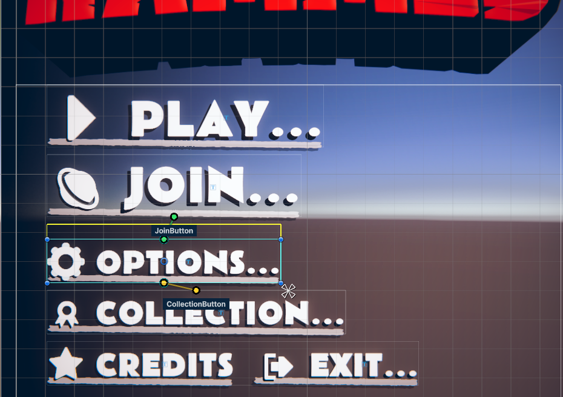
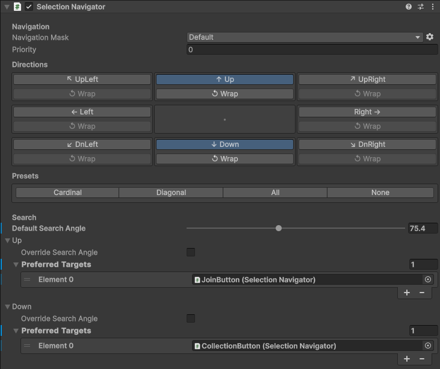
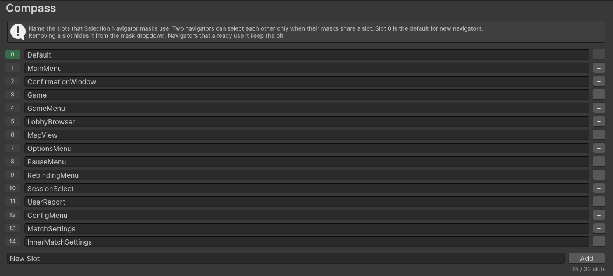

# Compass

Spatial selection navigation for uGUI in Unity 6. Add a Selection Navigator to your buttons, and a d-pad, stick or arrow key press selects the nearest selectable in that direction. You don't wire explicit navigation links, so moving or resizing elements doesn't break anything.



## Install

Compass needs Unity 6.0 or later. In **Window > Package Manager**, click **+ > Add package from git URL** and paste:

```console
https://github.com/Tirtstan/Compass.git
```

Add `#v1.0.0` to the end of the URL to pin a version.

## Use

1. Make sure your scene has an EventSystem with an input module.
2. Add **Compass > Selection Navigator** to each `Selectable` that should take part in navigation.
3. Enter Play Mode and move with a d-pad, stick or arrow keys.

Compass sets each `Selectable`'s Navigation mode to None so Unity's built-in navigation doesn't also run.



Each navigator has these settings:

- **Directions** picks which of the 8 directions it handles, and which of them wrap to the other end of the row or column when nothing is found.
- **Preferred Targets** lists, per direction, targets to try before the spatial search. The first valid one wins.
- **Search Angle** sets how wide the search cone is. You can override it per direction, and 0 turns off the spatial search for that direction.
- **Priority** breaks ties between candidates at the same distance.

While a navigator is selected, the Scene view draws its links. Preferred links are solid, spatial links are dotted, and wrap links have a "(wrap)" label.

### Masks

Masks keep separate menus from selecting each other, such as a popup and the menu behind it. Two navigators can reach each other only when their masks share a slot.

Name the slots in **Edit > Project Settings > Compass**, then pick them in each navigator's Navigation Mask dropdown. The names are saved to `ProjectSettings/CompassSettings.asset`, so commit that file.



## Scripting

Every Inspector setting has a matching property or method in the `Compass` namespace.

```csharp
using Compass;

confirm.ReplacePreferredTargets(SelectionNavigationDirection.Down, new[] { cancel });
confirm.SetSearchAngle(SelectionNavigationDirection.Right, 20f);
confirm.AllowedDirections = SelectionNavigationDirection.All;

SelectionNavigator next = confirm.FindTarget(SelectionNavigationDirection.Down);
```

## License

[MIT](LICENSE.md)
